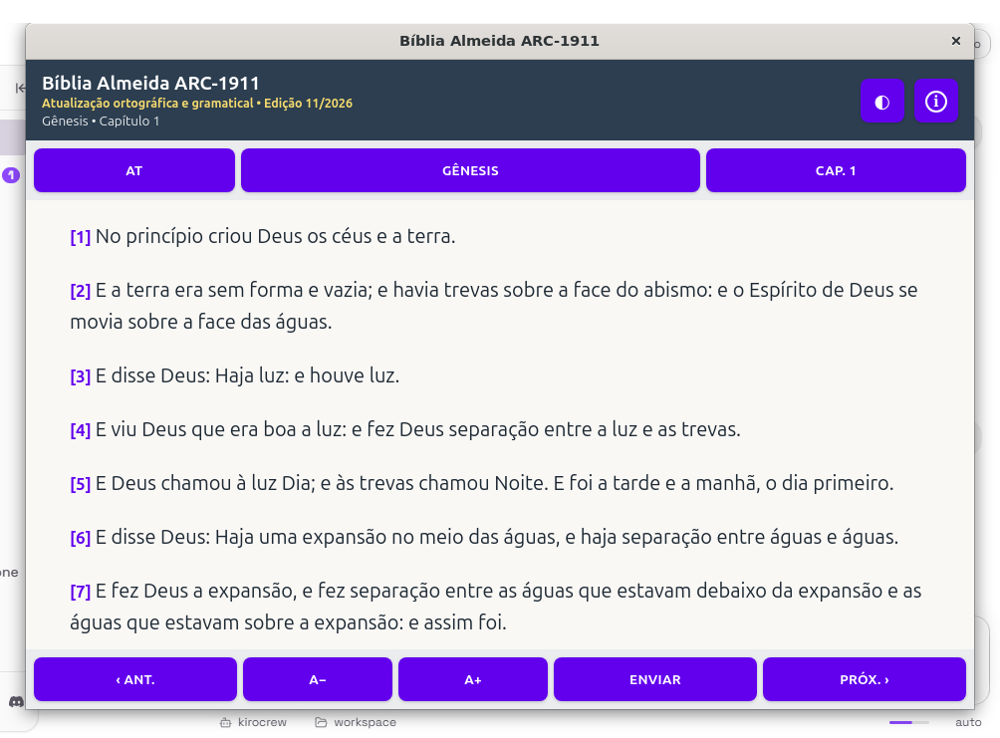

# Bíblia Almeida ARC-1911 — Aplicativo para Linux

## 📥 [BAIXAR PARA LINUX (clique aqui)](https://github.com/RomuloCSR/biblia-almeida-arc1911-aplicativo-linux/releases/latest/download/BibliaARC1911-Linux.tar.gz)

**Gratuito • Sem anúncios • Funciona sem internet • Sempre a versão mais nova**

Ou aponte a câmera do celular para o código abaixo e envie o link para o seu computador:


**Usar em 3 passos:**

1. Clique em **BAIXAR PARA LINUX** acima. O arquivo `BibliaARC1911-Linux.tar.gz` será baixado.
2. Na pasta *Downloads*, clique com o botão direito no arquivo → **Extrair aqui**.
3. Abra a pasta `BibliaARC1911` e dê **dois cliques** em **`biblia`** (se perguntar, escolha **Executar**).

> Não abriu? Abra o Terminal e instale a peça que falta (uma vez só): `sudo apt install -y libwebkit2gtk-4.1-0`
>
> O programa pronto é para **Ubuntu 26.04 ou mais novo**. Em versões mais antigas, use o jeito de compilar, mais abaixo.

**Compartilhe com quem precisa:** copie e envie este link:

```
https://github.com/RomuloCSR/biblia-almeida-arc1911-aplicativo-linux/releases/latest/download/BibliaARC1911-Linux.tar.gz
```

---

Aplicativo **gratuito, leve e 100% offline** da Bíblia **Almeida 1911 (Domínio Público)**, com atualização ortográfica e gramatical realizada em **11/2026** para o Português do Brasil.

Feito para quem quer ler a Palavra **sem distrações**: tela limpa, letra grande, botões simples. Se a pessoa sabe ler, ela sabe usar.



> **Nota editorial:** O conteúdo está em processo contínuo de atualização e pode eventualmente apresentar pequenas falhas ortográficas ou gramaticais. Colabore nos enviando seu feedback pela aba **Issues** deste repositório. Obrigado!

---

## Por que usar

* **Sem internet.** Os 66 livros e os 1189 capítulos já estão dentro da pasta.
* **Roda do pendrive.** O app guarda onde você parou numa pasta `dados` ao lado dele.
* **Motor em C.** Rápido e leve: cada capítulo abre na hora.
* **Sem anúncios, sem cadastro, sem coleta de dados.**
* **Texto fiel à Almeida 1911.** Só a grafia foi atualizada para o português de hoje, sem mudar o sentido.

---

## Compilar você mesmo (Ubuntu, Debian, Linux Mint e parecidos, inclusive versões antigas)

1. Abra o **Terminal** e instale o que o app precisa (uma vez só):

```bash
sudo apt install -y git build-essential pkg-config libwebkit2gtk-4.1-dev
```

2. Baixe o aplicativo e gere o programa:

```bash
git clone https://github.com/RomuloCSR/biblia-almeida-arc1911-aplicativo-linux.git
cd biblia-almeida-arc1911-aplicativo-linux
./compilar.sh
```

3. Abra a Bíblia:

```bash
./biblia
```

Das próximas vezes, basta entrar na pasta e rodar `./biblia`.

---

## Como usar

| Botão | O que faz |
|---|---|
| **AT / NT** | Troca entre Antigo e Novo Testamento |
| **Nome do livro** | Abre a grade com todos os livros |
| **CAP.** | Abre a grade com os capítulos |
| **‹ ANT.** e **PRÓX. ›** | Capítulo anterior e próximo |
| **A−** e **A+** | Diminui e aumenta a letra |
| **ENVIAR** | WhatsApp, Telegram, E-mail, X ou Copiar |
| **◐** | Tema claro, sépia ou escuro |
| **i** | Sobre o projeto |

**Dicas:**

* **Enviar só um versículo:** clique no versículo para marcar e depois em **ENVIAR**.
* Ao enviar, o texto **também é copiado**. Se precisar, cole com `Ctrl` + `V`.
* O app **lembra** onde você parou, o tamanho da letra e o tema.

### Atalhos

* **`←`** e **`→`** — Capítulo anterior e próximo.
* **`Ctrl`** + **`+`** / **`-`** (ou **`Ctrl`** + roda do mouse) — Aumenta ou diminui a letra.
* **`Ctrl`** + **`0`** — Volta a letra ao tamanho normal.
* **`Esc`** — Fecha a janela de livros ou capítulos.

---

## Este aplicativo é seguro?

**Sim.** Este é um projeto independente, gratuito e sem fins lucrativos, publicado em código aberto no **GitHub**.

* **Transparência total:** todo o código (`motor/motor.biblia.c`, `src/app_linux.c` e `ui/index.html`) e os textos dos 66 livros estão abertos nesta página.
* **Funciona sem internet.** O app só usa a internet quando **você** clica em **ENVIAR** ou em **Abrir GitHub**.

---

## Para desenvolvedores

```
textos/*.md  ->  motor/motor.biblia.c  ->  src/app_linux.c (janela GTK)  ->  ui/index.html (tela, WebKitGTK)
```

| Pasta / arquivo | O que é |
|---|---|
| `motor/motor.biblia.c` | Motor de limpeza e atualização ortográfica |
| `src/app_linux.c` | Janela do Linux (GTK 3 + WebKitGTK 4.1) |
| `ui/index.html` | Visual do aplicativo (HTML, CSS e JavaScript) |
| `textos/` | Os 66 livros (1189 capítulos), texto base da Almeida 1911 |
| `compilar.sh` | Gera o programa `biblia` |
| `empacotar.sh` | Gera o `BibliaARC1911-Linux.tar.gz` para anexar na release |

---

* **Autor:** Romulo CSR ([github.com/RomuloCSR](https://github.com/RomuloCSR))
* **Apoio espontâneo (PIX):** `21980934118`
